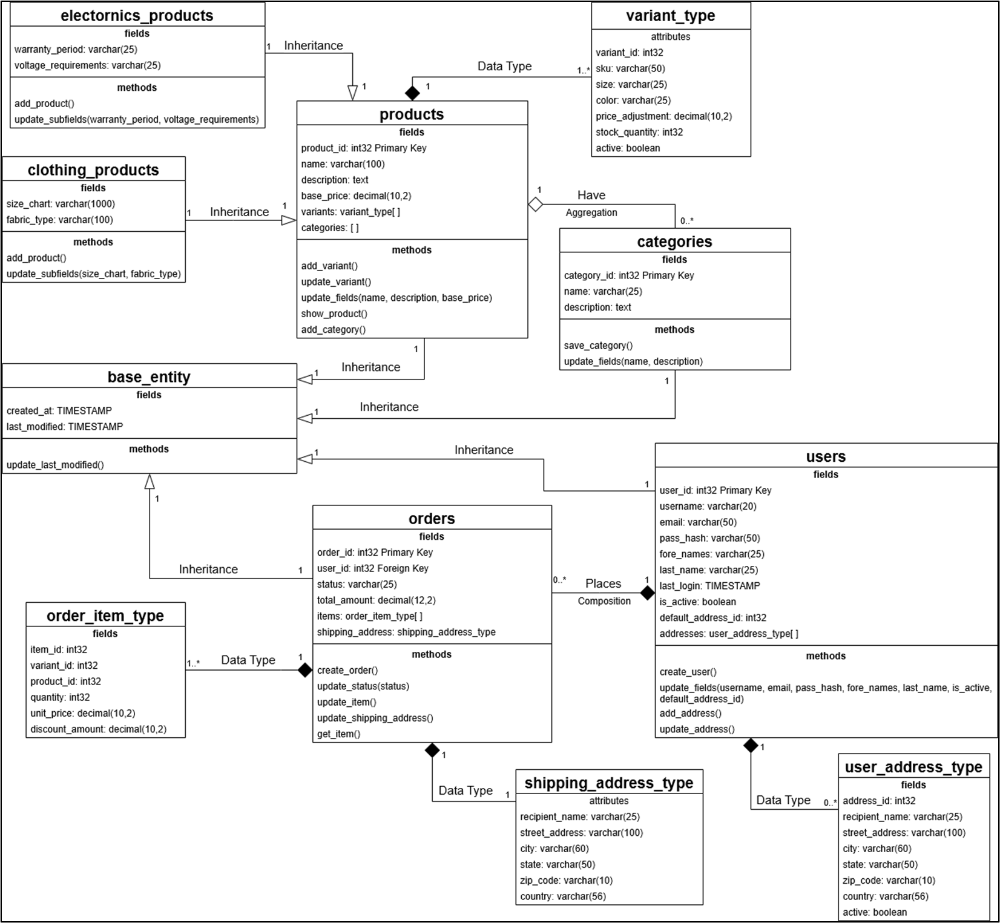

# PostgreSQL-v-MongoDB_UniProject_Comparative-Analysis
This is a graded uni project to showcase the learning of the Advanced Database Technologies module by doing a comparative analysis of MongoDB and PostgreSQL for a similarly structured dataset.

***

The goal was to perform 5 queries with SQL and build similarly structured MongoDB aggregation pipelines. The database chosen for this submission was an ecommerce databasse which may not be the best option for NoSQL as it is built to store far bigger and unstructured data. However, trying to implement relational data in MongoDB gave a unique insight into how it can be used to perform similar tasks such as an SQL database and how it reached the same results with a completely different process.

AI was only used to generate the randomized datasets (even then, a lot of manual input was necessary as it was a free version of AI that could not keep track of all the records). Everything else was done solely on my own so I could showcase my learning in this semester and grow a better understanding as well while solving these tasks.

Here is a UML diagram of the DB from the full report that was built in both MongoDB and PostgreSQL:

  

The .sql and .js script in this repo can be used to create the databases used in this assignment. Please read the comments before running the script as minor adjustments might be needed based on your environment. The mongodb script contains the validators and indexes and both scripts drop any existing data before adding any data from the script so be careful before running them on a DB with pre-existing data (not that anyone would do that).

As for the querying tasks, these were the 5 operations we were supposed to perform with both databases:

**Query A:** A join of three or more tables – you should consider various types of join in this query (e.g. inner join, left/right/full outer joins, etc.) and the query must include a restriction on the rows selected 
**Query B:** A query which uses one (or more) of the UNION, DIFFERENCE or INTERSECT operators. 
**Query C:** A query which requires use of either an array or table inheritance 
**Query D:** A query using temporal features (e.g., timestamps, intervals, etc.) 
**Query E:** A query using OLAP (e.g., ROLLUP, CUBE, PARTITION) features

To see the queries, pipelines, and their results, please go to the last section of the report. The report is available in this repo in both pdf and docx.
